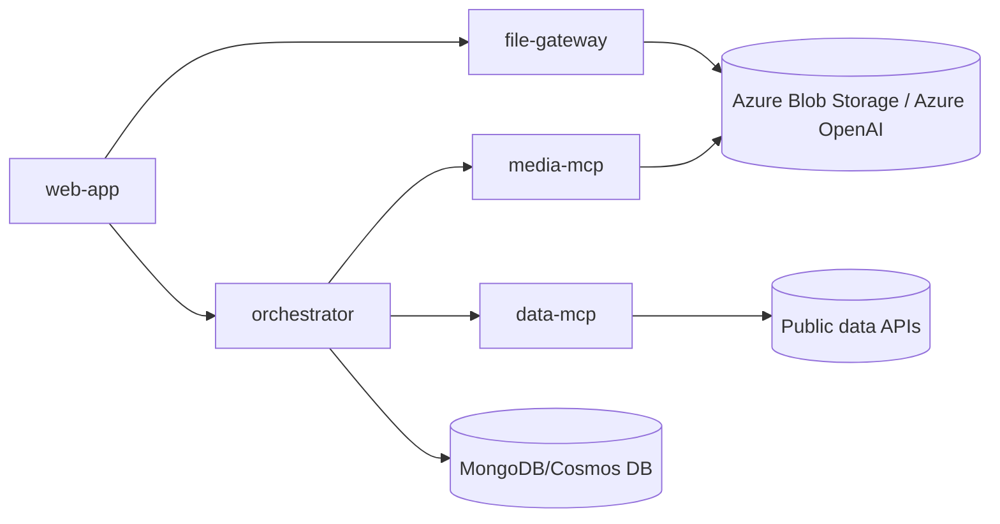

# Platform — Local Service Startup Reference

How to start `orchestrator`, `data-mcp`, `media-mcp`,
`file-gateway`, and `web-app` locally, in normal mode and in a
debugger-attached mode.

See also: `bug-workflow`/`story-workflow` for when to start these
services; `e2e-verification` for auth bypasses and live
Azure-backed verification once they're up;
`vault://wiki/notes/service-registry.md` for repo paths, deployed
versions, and caveats in one read. That page carries no port. This skill and
the `services` tool do.

## Absolute rule: never stop a process this task does not own

A process already listening on a port belongs to another session until
proven otherwise. Before every start, check the port. If another process
owns it, never stop, kill, or restart it, under any circumstance — not
even with the user's live authorization. This holds for the `services`
tool, every raw `hub`/`kill` command, and every session, with no
exception. Pick a different port, wire callers to the alternate port, or
ask the user to coordinate directly with the other session's owner. This
is not a judgment call to weigh against convenience.

`.omp/extensions/process-ownership-guard.ts` enforces this rule in code.
Ownership belongs to the OMP process. `services` adds each service it
starts to the guard ledger, so a later stop in the same OMP process passes. A `kill` of a
literal PID passes only for a child of this session, or for a process whose
working directory is inside the `cwd` of a process this session started
(the debugpy helper case below). A block reason starting with
`process-ownership-guard:` is final. Do not look for a workaround. Report it.

## Primary interface: the services tool

The `services` tool (`.omp/extensions/services/`) owns the local
lifecycle of all 5 services: port checks, dependency setup, start, sibling
wiring, health checks, and stop. Call it from the main agent. Do not run
the start commands below by hand.

| Service id | Repo dir | Default port | Default debug port |
|---|---|---|---|
| `file-gateway` | `file-gateway` | `9000` | `5681` |
| `media-mcp` | `media-mcp` | `8001` | `5680` |
| `data-mcp` | `data-mcp` | `8002` | `5679` |
| `orchestrator` | `orchestrator` | `8000` | `5678` |
| `web-app` | `web-app` | `5173` | none (no process debugger) |

`.omp/extensions/services/plan.ts` holds these defaults and the start
argv. That file is authoritative; this table mirrors it.

Parameters:

- `action`: `start`, `stop`, `restart`, `status`, or `logs`.
- `services`: a list of service ids, or `"all"`. Required for `start` and `restart`. `stop` defaults to every service this session started. `status` defaults to all. `logs` takes exactly one.
- `task_dir`: the task folder that holds the repo links. Default: the session cwd.
- `repo_paths`: a worktree path per service. It overrides `<task_dir>/<repo dir>`, for example for a pre-fix checkout.
- `debug`: the services to run in debug mode. The others run in normal mode.
- `ports`, `debug_ports`: explicit ports per service. An explicit port is strict.
- `env`: an env map per service, for this call only.
- `lines`, `grep`: `logs` only. `lines` defaults to 40. `grep` is a regex filter.

Examples:

```json
{"action":"start","services":"all","task_dir":"<TASK>"}
{"action":"restart","services":["media-mcp"],"debug":["media-mcp"]}
{"action":"stop"}
```

Port policy: the tool tries the canonical port first. If a foreign process
holds it, the tool picks the next free port, skips every canonical port, and
wires the siblings to the port it got. An explicit port is strict: a busy
one fails with `port_in_use` and the owner's PID, cwd, and command.
`web-app` is always strict: 5173 unless you pass a port. The tool never
stops a process it did not start.

Env precedence: inherited process env < tool wiring < the `env` you pass.
The tool checks that `.env` exists. It never reads or writes it.

Set web-app flags through `env`:
`{"web-app": {"VITE_SHOW_ORCHESTRATOR_AGENT": "true"}}` shows the
orchestrator UI. `{"web-app": {"VITE_DEV_HTTPS": "false"}}` serves
plain HTTP.

Process host: each service runs in its own process group and writes a log
file under `$TMPDIR/services/<session id>/`. It does not show in
`proc://` or `omp ps`. Read logs with `action: logs`, or `read` the
`log_file` path from the result. Services stop when the omp session ends. A
service that a subagent starts stops when that subagent ends.

Error codes (`error.code`, per service): `repo_missing`, `needs_env`,
`setup_failed`, `docker_unavailable`, `port_in_use`, `no_free_port`,
`debug_unsupported`, `start_failed`, `health_failed`, `dependency_failed`,
`not_owned`, `ambiguous_service`. After `health_failed` the process stays up
for inspection. Stop it with `action: stop`.

orchestrator: every start runs
`docker compose -p orchestrator-local-mongo -f docker-compose.local.yaml up -d --wait mongodb`.
Stop leaves Mongo up. A Docker failure returns `docker_unavailable`. Start
Colima yourself. The app loads MCP tools once, at startup, so restart
the orchestrator after a sibling MCP server comes up later. `wiring_log` in the
start result lists the `mcp_image_generation_url=` value the app printed and
each `POST http://localhost:<n>/mcp` request it made. The startup log does
not print the data-mcp URL, so the `POST` line is the proof for it.

The tool encodes every gotcha below. The sections below explain why.

## Canonical local ports

Sibling URLs are hardcoded in each repo's `.env`, not discovered. A service
that falls back to a different port still passes its own health check while
every caller that was not rewired keeps hitting whatever squats on the
canonical port. `services` rewires the siblings it starts in the same
call or that run under this session. Any other caller still uses the
canonical port, and the start result warns about it.

**Detecting a stale/foreign process before trusting its health check:**
before every start, run `lsof -nP -iTCP:<port> -sTCP:LISTEN`. If a PID is
already listening, check its identity with `lsof -a -p <pid> -d cwd` (macOS
`ps` has no `cwd` output specifier at all) and `ps -p <pid> -o
pid,etime,command`. A process whose `cwd` doesn't match the expected
worktree, or whose `etime` is minutes old right after a "just started it"
claim, is someone else's process — never kill it; report the conflict and
pick a different port instead.

**After a start:** the tool already checked port ownership, the PID `cwd`,
and health. Call it from the main agent only. A service that a subagent
starts stops with that subagent.

**Process start commands:** use absolute paths. A task-folder repo is a
symlink, so `..` from the repo resolves into the `*-bare` directory.

| Service | Protocol |
|---|---|
| `file-gateway` | HTTP |
| `media-mcp` | HTTP (MCP at `/mcp`) |
| `data-mcp` | HTTP (MCP at `/mcp`) |
| `orchestrator` | HTTP |
| `web-app` | HTTPS (mkcert; HTTP if `VITE_DEV_HTTPS=false`) |

The file-gateway default port is also where an unrelated, permanent Colima ssh
mux commonly squats on this workstation. If `lsof` on that port shows an `ssh`
process whose `cwd` has nothing to do with `file-gateway`, that is
expected background noise, not a conflict to resolve. `services` then
starts file-gateway on the next free port. Never touch that `ssh` PID.

**When the canonical port is held by another task's live stack:** start on
an alternate free port AND override every caller's env var to match (e.g.
media-mcp on 8011 → set `AGENT_MCP_IMAGE_GENERATION_URL=http://localhost:8011/mcp`
on orchestrator). One without the other silently wires the
caller to the squatter. `services` does both when it starts the caller
in the same call or the sibling runs under this session.

## Cross-wiring detection: health checks alone are NOT sufficient

Run this check whenever more than one task folder's stack (same repos,
different branches) may be running concurrently. Per-service health checks
passing does NOT prove the stack is internally consistent. Several repos
hardcode sibling-service URLs as absolute `http://localhost:<port>` values
in their own `.env` rather than resolving them dynamically. A service that
fell back to a non-canonical port because the canonical one was taken will
still report healthy — while its actual callers keep hitting whatever else
(a different task's stack, or a third, unrelated task's orphaned process)
occupies the canonical port its `.env` names. This produces a fully-green
but cross-wired stack that silently validates the wrong branch's code.

Before trusting the stack as ready:

1. Determine each service's expected sibling ports/URLs. `.env` reads are
   allowed, but the `guardrails` extension masks secret-looking values as
   `*****` for you and any subagent, so a value you need may be hidden.
   Derive it from live evidence instead: read the proxy config
   source (e.g. `vite.config.ts`, not `.env`) for which env var feeds which
   proxy target; fetch a dev server's live transformed config over HTTP if it
   serves one; or read a startup log line that echoes resolved upstream URLs.
2. Cross-check with `lsof -i :<port>` to see which task's worktree actually
   owns each canonical port right now, then confirm with `lsof -a -p <pid>
   -d cwd` (macOS `ps` has no `cwd` output specifier — `ps -o cwd` fails
   with `unknown output format specifier 'cwd'`; that keyword is
   Linux/procps-only) and `ps -p <pid> -o pid,etime,command` for uptime.
   A process whose `lsof`-reported cwd doesn't match the expected task-folder
   worktree, or whose `etime` is minutes old right after a "just started it"
   claim, is
   someone else's process — not evidence of your own success.
3. If a fallback-port service's sibling still points at the canonical port,
   and a different task's process holds that port, the stacks are
   cross-wired. Never free the canonical port by stopping the other task's
   process — see "Absolute rule" above; that process belongs to another
   session and stays up, with no exception and no authorization that
   overrides this. Fix it from this task's side only: keep this task's
   service on its fallback port and override every caller's env var to
   match (see "When the canonical port is held by another task's live
   stack" above), or ask the user to coordinate a port reassignment
   directly with the other session's owner.
4. Prove the full request chain end-to-end with real requests and matching
   timestamped log lines on BOTH the caller and callee side of every hop —
   this, not an isolated health check, rules out silent cross-wiring.
   Delegate this correlation to the `error-detective` agent when the chain
   spans more than two repos: give it the reproduction request, the exact
   timestamp window, and the list of services in the chain, and require it
   to cite the matching log line on both sides of every hop, not a bare
   health-check pass.
5. One worker's own troubleshooting (e.g. `pkill`/`kill -9` on what it
   thinks is its stuck process) can collaterally kill a different,
   already-healthy sibling service, including one owned by another
   session. Never target a PID by guessed name or port alone — always run
   the cwd/etime identity check first, and never kill a PID that fails it.
   After every startup finishes, re-verify every service's health
   independently and freshly — never rely on a cached prior report.

## Dependency graph and start order



1. `file-gateway`, `media-mcp`, `data-mcp` — no
   dependency on each other or on any other repo here; start in any order.
2. `orchestrator` — needs MongoDB and reaches out to the two
   MCP servers above.
3. `web-app` — needs `orchestrator` and
   `file-gateway` up first.

All four Python services expose `GET /health`. Drop `--reload` whenever a
debugger is attached: uvicorn's `--reload` forks a child process the
debugger can't see, so breakpoints never hit — every `services`
debug-mode start already omits it.

## The debugpy dependency: only media-mcp declares it

Only `media-mcp`'s `pyproject.toml` lists `debugpy` as a dev
dependency. `orchestrator`, `file-gateway`, and
`data-mcp` do not — `uv run python -m debugpy ...` against those
three fails outright with `No module named debugpy` unless one of two
things has already put it in the venv:

- `~/work/<PROJECT>/tasks/setup-task-lsp.sh <task_dir>` was run for this task
  folder (it really does install a working `.venv/bin/debugpy` console
  script into every Python repo that's missing one, confirmed by reading
  its source — it just does nothing for a checkout it was never pointed
  at, such as an ad-hoc sandbox with no `.task-root` marker).
- The debug-mode start command uses `uv run --with debugpy python -m
  debugpy ...` instead of plain `uv run python -m debugpy ...` — this
  resolves `debugpy` as an ephemeral dependency at invoke time (a few
  seconds of "Resolving dependencies..." on first use, then cached),
  without touching the repo's `pyproject.toml` or lockfile. `services`
  uses this form for the 3 repos that need it; media-mcp does not need it,
  since the dependency is already declared.

If a debug-mode start ever fails with `No module named debugpy` again, the
argv table in `.omp/extensions/services/plan.ts` has regressed — fix
it to use `--with debugpy`, don't hand-edit the target repo's
`pyproject.toml`.

## Debug-mode readiness: never probe `debug_port` with a connect

`debugpy` allows exactly one client to attach for the life of a listen
session. Any TCP connect-then-close against `debug_port` — including
`hub`'s own `ready.port` readiness probe — is treated as a real client and
silently burns that one slot before the real debugger ever gets to attach,
poisoning the session before it starts. This was directly observed and
proven (via `DEBUGPY_LOG_DIR`-captured logs showing a client
connect-and-reset at the exact moment `hub`'s probe ran).

Consequently, every `services` debug-mode start uses no
`ready` gate at all. Readiness is proven only by a passive check that never
connects:

```bash
lsof -nP -iTCP:<debug_port> -sTCP:LISTEN
```

`<port>` also stays closed under `--wait-for-client` until a debugger
attaches, so it can't gate readiness either — that's expected, not a
failure.

## Attaching a debugger: the built-in `debug` tool does not work here; use a raw DAP socket

The built-in `debug` tool's `attach` action (adapter `debugpy`) was tested
against a genuinely clean, unpoisoned `debugpy` listener and
timed out with no session ever created (confirmed via `debug(action:
"sessions")` → "No debug sessions"). This is a confirmed limitation of
that tool against this target, not a poisoning artifact — most likely
because `debugpy` defers its `attach` response until `configurationDone`
arrives, and the built-in tool doesn't send that step.

The proven-working fallback is a hand-rolled raw-socket DAP client run in
the `eval` Python kernel, connecting directly to `127.0.0.1:<debug_port>`
(the target's own internal `--for-server` helper speaks DAP directly to
any raw client — no intermediary adapter process is needed):

```python
import socket, json, time

class DapSocketClient:
    def __init__(self, host, port):
        self.sock = socket.create_connection((host, port), timeout=10)
        self.seq = 0
        self.buf = b""

    def read_message(self, timeout=10):
        self.sock.settimeout(timeout)
        while True:
            if b"\r\n\r\n" in self.buf:
                header, rest = self.buf.split(b"\r\n\r\n", 1)
                length = int(header.split(b":")[1].strip())
                while len(rest) < length:
                    rest += self.sock.recv(65536)
                msg, remainder = rest[:length], rest[length:]
                self.buf = remainder
                return json.loads(msg)
            chunk = self.sock.recv(65536)
            if not chunk:
                raise ConnectionError("socket closed")
            self.buf += chunk

    def send_message(self, obj):
        data = json.dumps(obj).encode()
        header = f"Content-Length: {len(data)}\r\n\r\n".encode()
        self.sock.sendall(header + data)

    def send_request(self, command, arguments=None):
        self.seq += 1
        seq = self.seq
        msg = {"seq": seq, "type": "request", "command": command}
        if arguments is not None:
            msg["arguments"] = arguments
        self.send_message(msg)
        return seq

    def wait_for_response(self, request_seq, timeout=15):
        deadline = time.time() + timeout
        while time.time() < deadline:
            msg = self.read_message(timeout=max(0.1, deadline - time.time()))
            if msg.get("type") == "response" and msg.get("request_seq") == request_seq:
                return msg
        raise TimeoutError(f"no response for request_seq={request_seq}")

client = DapSocketClient("127.0.0.1", debug_port)
seq = client.send_request("initialize", {
    "clientID": "omp", "adapterID": "debugpy",
    "linesStartAt1": True, "columnsStartAt1": True, "pathFormat": "path",
})
client.wait_for_response(seq)  # success: True

seq_attach = client.send_request("attach", {"justMyCode": False})
client.send_request("configurationDone")  # fire and forget; response may never arrive, that's fine
attach_resp = client.wait_for_response(seq_attach, timeout=20)  # success: True unblocks the app
```

Match every response by `request_seq`, not just `type`/`command` —
unsolicited `output`/`thread`/`module` events interleave with real
responses at any point, not only before `initialize`. Keep the socket
open for the life of the debug session; closing it disconnects the
client (only one client may be attached at a time). Once attached, set
breakpoints (`setBreakpoints`, absolute `source.path`), `continue`, and
read `stackTrace`/`scopes`/`variables` exactly per the DAP spec — a real
breakpoint hit and inspection was proven end to end against
`media-mcp`, including a live MCP `tools/call`
request stopping exactly where expected.

## Stopping a debug-mode instance: `hub stop` leaves an orphaned helper

`services` `action: stop` runs this check and kill itself and reports
`debug_port_free`. The manual steps below apply only to a debug process
started some other way.

`debugpy` double-forks its internal adapter helper
(`debugpy/adapter --for-server ... --port <debug_port> --server-access-
token ...`) to daemonize it on POSIX, reparenting it to PID 1. `hub stop`
killing the main process tree does not reap this helper, so `<debug_port>`
stays listening even after `hub ps` already shows `exited`. After every
debug-mode stop:

```bash
lsof -nP -iTCP:<debug_port> -sTCP:LISTEN
```

If a PID is still listening, verify its identity before touching it —
`ps -p <pid> -o pid,ppid,etime,command` should show `ppid` `1` and a
command line matching `debugpy/adapter --for-server ... --port
<debug_port> ...` for this same repo/token. Only once confirmed, kill it
directly (`kill <pid>` — no `hub` process owns it) and re-run `lsof` to
confirm the port is free. Never kill a PID whose command or `ppid`
doesn't match this exact pattern.

## web-app: no process debugger, and don't probe its port over IPv4

Vite's dev server (`pnpm exec vite --port <port> --strictPort`) is the
same process for "normal" and "debug" — there is no process-level
debugger for this SPA. Use Chrome DevTools → Sources against the running
page, or a VS Code `chrome` launch config
(`"request": "launch"`, `"url": "https://localhost:<port>"`,
`"webRoot": "${workspaceFolder}"` — no `.vscode/launch.json` is pre-wired).

Vite's dev server binds `[::1]` (IPv6 loopback) only, not `127.0.0.1`.
`hub`'s `ready.port` probe checks IPv4 specifically, so pairing it with
Vite's `ready.log` gate produces a spurious timeout even once the server
is genuinely up (confirmed). The `services` web-app
start therefore uses `ready.log` only, no `ready.port`; treat a `curl`
against the `localhost` hostname (which resolves to the IPv6 loopback) as
the real readiness proof, not a raw-IP `lsof`/connect check.

## PR-build checks per repo

These are the commands the PR pipeline runs. Run the same set locally before
you push. Every workflow skill links here; do not copy the table elsewhere.
Verified against each repo's PR yaml on `main`, 2026-10-16.

| Repo | Commands |
|---|---|
| web-app | `pnpm run lint`; `pnpm run typecheck`; `pnpm run test:ci`; `pnpm run build` |
| orchestrator | `uv run ruff check app/ tests/ e2e/ scripts/`; `uv run ruff format --check app/ tests/ e2e/ scripts/`; `uv run pytest tests/`; `uv run pytest e2e --no-cov` |
| media-mcp | `uv run ruff check src/ tests/`; `uv run ruff format --check src/ tests/`; `uv run pytest tests/` |
| data-mcp | `uv run ruff check src/ tests/`; `uv run ruff format --check src/ tests/`; `uv run pytest tests/ -m "not integration"` |
| file-gateway | `uv run ruff check .`; `uv run ruff format --check .`; `uv run mypy src`; `uv run pytest tests/` |
| analytics | `uv run ruff check .`; `uv run ruff format --check .`; `uv run pytest` |
| infra | none locally; the infra gated pipeline validates the PR |

Notes: `orchestrator` fails the run under 85 % coverage
(`pyproject.toml`). The `integration`-marked tests in `media-mcp`
and `data-mcp` are not in the PR build; run them once against real
dependencies before a story is called done.

## Dev-only features

Some behaviour runs only on dev or higher, never locally: internal policy
documents, image generation, and the full time limits the assistant has in prod. A
local "clean" result on one of these is not evidence. Say so in the report
and verify on dev (pipeline `<E2E_PIPELINE_ID>` for API and answer changes) or on QA.

## Per-service quick reference

### 1. file-gateway

Python 3.12, FastAPI + uvicorn, `uv`. Proxies Azure Blob Storage behind
Azure AD auth. No dependency on the other 4 services.

- Normal: `uv run uvicorn src.main:app --host 0.0.0.0 --port <port> --reload`
- Debug: `uv run --with debugpy python -m debugpy --listen 0.0.0.0:<debug_port> --wait-for-client -m uvicorn src.main:app --host 0.0.0.0 --port <port>`
- Health: `curl http://localhost:<port>/health` → `200 OK`
- Fresh worktree: run `uv sync --all-groups` before `uv run pytest`.

### 2. media-mcp

Python 3.14, FastMCP + uvicorn, `uv`. Generates images/presentations via
Azure OpenAI and uploads them to Azure Blob Storage. Only repo of the 4
that already declares `debugpy` as a dependency — no `--with` needed.

- Normal: `uv run uvicorn src.main:app --host 0.0.0.0 --port <port> --reload`
- Debug: `uv run python -m debugpy --listen 0.0.0.0:<debug_port> --wait-for-client -m uvicorn src.main:app --host 0.0.0.0 --port <port>`
- Health: `curl http://localhost:<port>/health` → `{"status":"healthy","service":"media-mcp-server"}`
- Fresh worktree: run `uv sync --all-groups` before `uv run pytest`.
- MCP tool calls: `POST http://localhost:<port>/mcp` with
  `Accept: application/json, text/event-stream`, JSON-RPC `tools/call`
  body naming a tool (`generate_image`, `render_presentation`,
  `render_word_document_generation`) — stateless HTTP mode, no `initialize`
  handshake required first, though sending one first is harmless.

### 3. data-mcp

Python 3.14, FastMCP + uvicorn, `uv`. Wraps public data APIs. No Azure
credentials required.

- Normal: `uv run uvicorn src.main:app --host 0.0.0.0 --port <port>` (no `--reload`)
- Debug: `uv run --with debugpy python -m debugpy --listen 0.0.0.0:<debug_port> --wait-for-client -m uvicorn src.main:app --host 0.0.0.0 --port <port>`
- Health: `curl http://localhost:<port>/health` → `{"status":"healthy","service":"data-mcp"}`
- Fresh worktree: run `uv sync --all-groups` before `uv run pytest`.

### 4. orchestrator

Python 3.12, FastAPI + uvicorn + LangGraph ReAct agent, `uv`. Needs
MongoDB/Cosmos DB. `ENV=local` is required for every local run (enables
the fake-auth bypass; without it, startup/auth fails).

- Normal: `ENV=local PORT=<port> uv run python -m app` (binds with `--reload`)
- Debug: `ENV=local uv run --with debugpy python -m debugpy --listen 0.0.0.0:<debug_port> --wait-for-client -m uvicorn app.main:app --host 0.0.0.0 --port <port>`
- Health: `curl http://localhost:<port>/health` → `{"status":"ok"}`
- Sibling wiring (env, never `.env` — `AgentConfig`'s `env_prefix="AGENT_"`
  silently ignores any other name):
  `AGENT_MCP_IMAGE_GENERATION_URL=http://localhost:<media-mcp port>/mcp`,
  `AGENT_MCP_DATA_URL=http://localhost:<data-mcp port>/mcp`.
- `AGENT_AZURE_ENDPOINT` must end in `/openai`
  (`https://<resource>.cognitiveservices.azure.com/openai`). The local `.env`
  value lacks it, and every turn returns 404.
- Local Mongo: run
  `docker compose -p orchestrator-local-mongo -f docker-compose.local.yaml up -d --wait mongodb`
  in the repo. Never run plain `up`, because it binds port 8000. Local Mongo
  does not prove Cosmos DB behaviour. If Colima fails, ask the user before
  you restart it.
- Fresh worktree: run `uv sync --all-groups` before `uv run pytest`.

### 5. web-app

Node 20 (`.nvmrc`), React 19 + Vite 8, `pnpm` (npm is blocked).

- Start: `pnpm exec vite --port <port> --strictPort` → `https://localhost:<port>`
  (`VITE_DEV_HTTPS=false` env override for plain HTTP)
- Debug: none at the process level — see the dedicated section above.
- Health: `curl -sk https://localhost:<port>/` → `200` (use GET, not `-I`/HEAD;
  a GET-only route correctly 405s a HEAD request, which looks like a
  false failure)
- Sibling wiring (env, never `.env` — Vite's `loadEnv` rule means process
  env always wins over `.env`):
  `VITE_ORCHESTRATOR_BASE_URL=http://localhost:<orchestrator port>`
  (required — the `vite.config.ts` fallback of `8004` matches nothing
  real), `VITE_FILES_BASE_URL=http://localhost:<file-gateway port>`.
- Whenever `port` isn't `5173`, also set
  `VITE_OIDC_REDIRECT_URI=<scheme>://localhost:<port>/callback` and
  `VITE_OIDC_POST_LOGOUT_REDIRECT_URI=<scheme>://localhost:<port>/`. In the
  Entra account picker, pick `<YOUR_EMAIL>`. Treat
  `AADSTS50011` (redirect URI not registered) as the cause only after you
  click through the picker.
- Fresh worktree or lockfile change: run `pnpm install --frozen-lockfile`,
  then restart Vite. Stale `node_modules` gives a Vite 500 on import.
- Use the repo OIDC values. A fake `VITE_OIDC_ISSUER` makes the login button
  do nothing.
