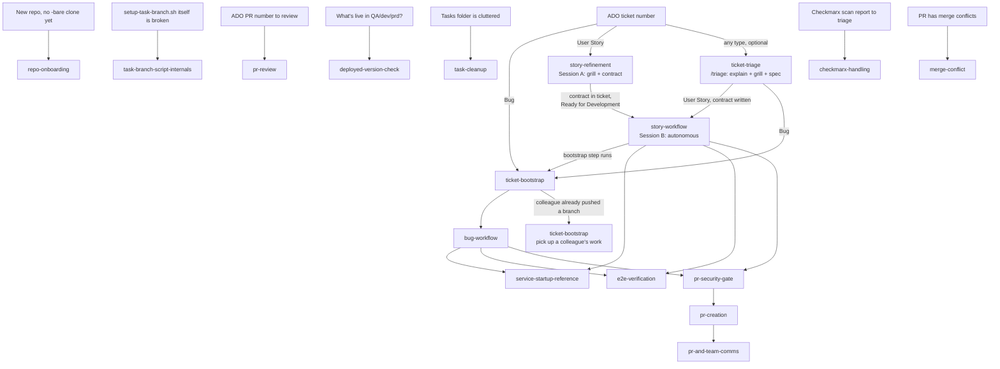

# Platform — Task Workflow Map

This is the index for every skill under `~/work/<PROJECT>/tasks/.omp/skills/`. Each
sibling skill is self-contained and independently loadable — load only the one
you need for the phase you're in. This skill exists to show how they connect.

Stories run as **two separate sessions**. See the story split in `AGENTS.md`.

## Phase → skill

| Phase | Skill | When it applies |
|---|---|---|
| Move the session into the ticket's task folder | `move_session` tool (rule in `.omp/RULES.md`) | First action when you pick up any ticket whose `*-<NUM>-*` folder exists; bootstrap does it for a new folder |
| Fetch ticket, create task folder, branch+worktree every repo | `ticket-bootstrap` | First step for Bugs; invoked by `story-workflow` ("Bootstrap") for Stories |
| Pull a colleague's already-pushed branch into the new task folder | `ticket-bootstrap` ("Pick up a colleague's existing work") | Someone else started the same ticket — the folder is still created by the standard flow |
| Wire LSP + DAP for a task folder | `ticket-bootstrap` ("Wire LSP and DAP") | After worktrees exist, for any task type |
| Verify a bug, write the failing test, fix it, mutation check, open a PR, move ADO state, record the vault entry | `bug-workflow` | Ticket type is Bug |
| A bug came back after a fix: read why, check the QA build, reproduce, plan a second fix | `ticket-bootstrap` "Detect a returned bug", then `bug-workflow` "Returned bug" | The state history reached Resolved, Ready for Retest or Closed, and the current state moved back |
| Grill the user, write the Agent Contract into the ticket, move to Ready for Development | `story-refinement` | Ticket type is User Story — Session A, interactive, runs before any bootstrap |
| Validate the contract, bootstrap, implement, test, open a PR, move ADO state, record the vault entry | `story-workflow` | Ticket type is User Story — Session B, autonomous from contract gate through PR creation and the PR-open Slack notification |
| Explain a ticket, grill, write an SDD spec with delegated tasks into the ticket | `/triage` (`ticket-triage` + `ticket-triage-profile`) | Any ticket type, before bootstrap; for a User Story it writes the Agent Contract, so it can replace `story-refinement` |
| Start/attach-debug any of the 5 platform services locally | `service-startup-reference` | Any time a service needs to run locally, from either workflow above |
| Prove a fix or feature works against real Azure OpenAI/Blob/Mongo, not just unit tests | `e2e-verification` | The "testing" step of either workflow, when a live check is needed |
| Decide where a regression test goes (repo tests, contracts.py, prompt catalogue, media check, component, browser journey) and prove a catalogue case locally | `regression-test-placement` | The "test first" step of either workflow, and the reviewer's test-strength check |
| After your PR merges: dev deploy check, dev evidence (pipeline `<PIPELINE_ID>`), tester handoff document, ticket comment draft | `post-merge` | From `pr-merge` "Report" or `morning-brief`, once per merged PR; moves no state |
| Merge your own PR after the gates pass, then move the work item one rung | `pr-merge` | Input is your own PR number, or a scan of your active PRs |
| Fix review comments on your own PR | `pr-comments` | Input is your own PR number with open threads |
| Which of your merged tasks are actually on QA | `tasks-deployed-to-qa` | Proves the QA deploy by ancestry, then moves `Resolved` to `Ready for Retest` and `Ready for Test` to `In Test` |
| Status of your open PRs across repos | `my-pr-status` | Read-only |
| What to work on today; close pass | `morning-brief` | Start of day |
| Playwright flow file for a UI bug | `flow-schema` | A bug with a `web-app` surface |
| Security gate before a PR or a push of own code | `pr-security-gate` | Before `pr-creation`, and before pushes to an open PR |
| PR title, description templates, work-item link, reviewers, auto-complete | `pr-creation` | The "PR creation" step of either workflow |
| Who to tell and where, review replies, vault decisions entry | `pr-and-team-comms` | After the PR exists |
| Bare-clone a repo that has no `-bare` clone yet and give it a `main` worktree | `repo-onboarding` | A repo is missing from `~/work/<PROJECT>/*-bare` entirely — `setup-task-branch.sh` can't help until this exists |
| Fix a bug in `setup-task-branch.sh` itself, or understand its exact directory/idempotency semantics | `task-branch-script-internals` | You're editing the script, not just running it |
| Review an existing ADO PR by number: task folder, PR-branch worktree, security + quality reviewer agents, verdict | `pr-review` | Input is a PR number, not a ticket — reviewing someone else's change, not implementing one |
| Check which tag/version is currently deployed to an environment (QA by default) | `deployed-version-check` | Input is a "what's live" question, not a task — read-only, returns a structured per-repo report |
| Archive and delete finished task folders, worktrees, and loose files | `task-cleanup` | Periodic housekeeping — input is a cleanup request, not a ticket |
| Download, triage, and ticket a Checkmarx One scan report | `checkmarx-handling` | Input is a scan report or a repo's vulnerability counts — produces Bugs, not a code change |
| Merge a PR's target branch into its branch and resolve the conflicts in the PR's own task folder | `merge-conflict` | Input is a PR number whose merge status reads "conflicts" — resolves a conflict only, changes no ticket state |
| What work happened on a given day | `daily-work-poll` | Input is a day; polls the tracker, local review folders, and git history; read-only |
| File a source (clipping, raw file) into the wiki | `wiki-ingest` | The user hands over a source |
| File a meeting transcript or notes: action items as tasks, attendees as people | `wiki-meeting` | The user hands over a transcript or captions |
| Work a task page or tracker item from the vault | `wiki-task-loop` | "Work a task", "pick up the next task" |
| Sync the vault with the tracker: push state, close merged tasks, pull new items, flag drift | `wiki-sync` | A sync or drift request |
| Answer a question from the wiki and cite pages | `wiki-query` | A question about the client, a project, a task, a person, a past event |
| Wiki health check: orphans, broken links, stale tasks | `wiki-lint` | A lint or maintenance request |
| Check Slack, search history, draft a message, write a manager update | `wiki-comms` | A Slack catch-up or draft request |
| Change wiki workflows, schema, or vault structure | `wiki-spec` | Before any change to a wiki skill, page type, field, folder, or gate |

## Constants

ADO org/project, the in-scope repo set, the `legacy-agent` exclusion, the team
Slack channel, and the Git/PR standards source live in `AGENTS.md` at
`~/work/<PROJECT>/tasks/.omp/AGENTS.md`. That file loads in every session, so
this skill does not repeat them.
